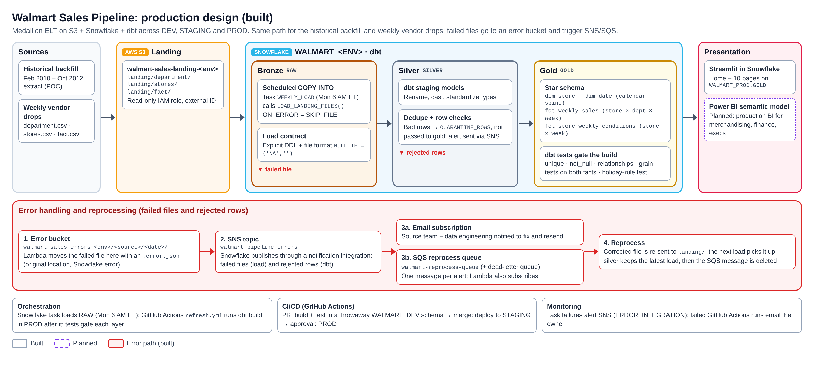
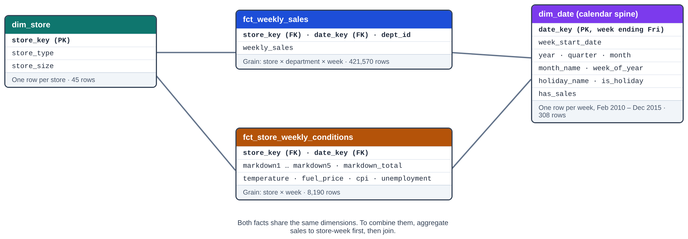
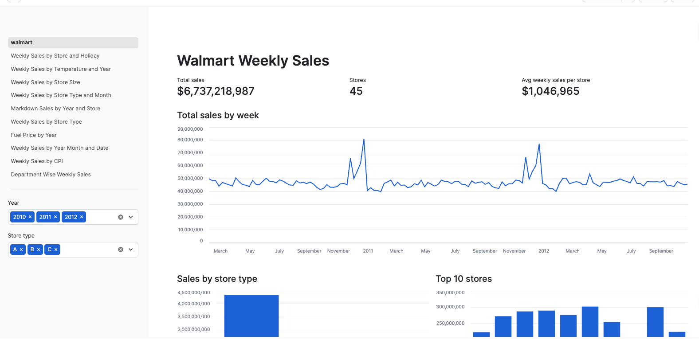
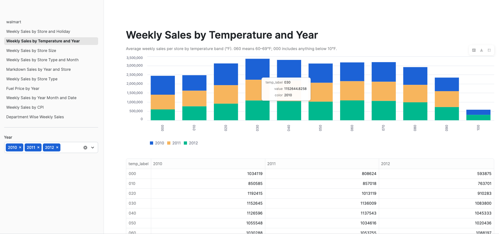
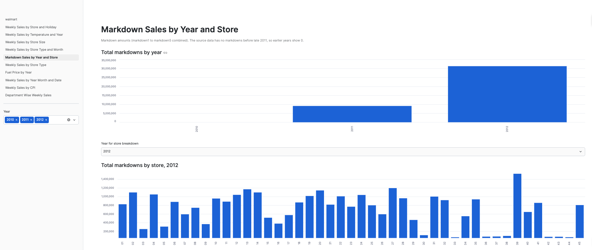
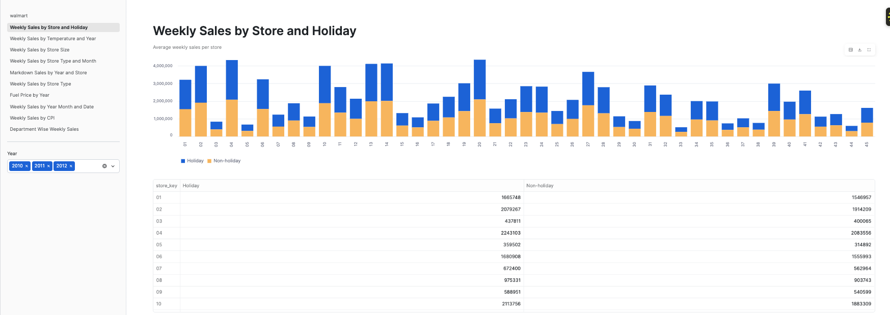
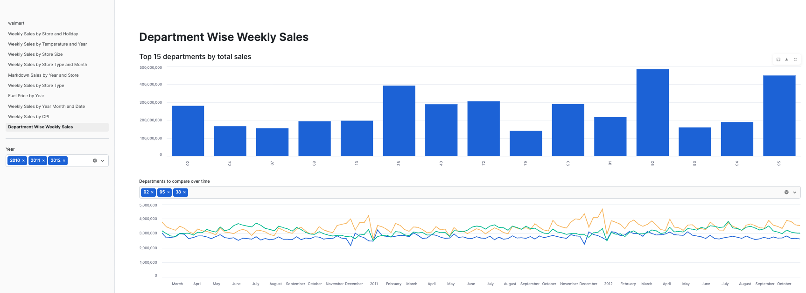

# Walmart Sales Analytics: S3, Snowflake, dbt, Streamlit

An end-to-end analytics pipeline. Raw CSV files in S3 are loaded into Snowflake, modeled into a star schema with dbt, and visualized in a multi-page Streamlit in Snowflake app.

## Architecture

**Built today:** CSV files (one S3 landing bucket per environment) -> Snowflake RAW (bronze, explicit load contract)
-> dbt staging (silver, de-duplicated) -> dbt marts (gold: 2 dimensions + 2 facts, each at its own grain)
-> Streamlit in Snowflake app. Separate DEV, STAGING and PROD databases.

**Production design (in progress):** the target architecture below adds automated ingestion, an error path and
environment promotion. Solid boxes are built; dashed boxes are being implemented next.

Planned additions:
- **Ingestion:** Snowpipe auto-ingest (the explicit load contract is already built)
- **Error handling:** failed files and rejected rows go to an error bucket; SNS alerts the source team and feeds an SQS reprocess queue
- **Backfill:** a parallel, date-parameterized job reprocesses corrected files without duplicating data
- **Orchestration:** scheduled dbt Cloud jobs, with tests gating each layer
- **CI/CD:** GitHub Actions running pull-request builds in DEV, then deploys to STAGING (QA) and PROD (the three environments are already built)
- **BI:** Power BI semantic model on the gold tables
  
## What I built

- Three environments (DEV, STAGING, PROD): one S3 landing bucket and one Snowflake database each, connected through a storage integration with a read-only IAM policy scoped to the `landing/` folders
- An explicit load contract: typed raw tables with NOT NULL keys and a file format that turns "NA" into NULL. Files that break it are skipped (`ON_ERROR = SKIP_FILE`), and every row records its source file and load time
- Silver staging models that de-duplicate re-sent rows (latest load wins)
- A dbt project with 3 staging models, 2 dimensions (`dim_store`, and `dim_date` as a calendar spine) and 2 fact tables, each at its true grain: `fct_weekly_sales` (store × department × week, about 421K rows) and `fct_store_weekly_conditions` (store × week)
- dbt tests: unique, not_null, relationships from each fact to each dimension, grain tests on both facts (`dbt_utils.unique_combination_of_columns` plus a custom singular test), and a test that the calendar's holiday rules match the source holiday flags
- A 10-page Streamlit app covering sales by store, holiday, temperature, store size, store type, month, markdowns, fuel price, CPI, and department

## Data model

| Table | Grain | Rows |
|---|---|---|
| `dim_store` | one row per store | 45 |
| `dim_date` | one row per week (calendar spine, Feb 2010 – Dec 2015) | 308 |
| `fct_weekly_sales` | one row per store, department, and week | 421,570 |
| `fct_store_weekly_conditions` | one row per store and week | 8,190 |

## Data quality decisions

- Weekly conditions (temperature, CPI, fuel price, markdowns) are recorded per store and week, so they live in their own fact table at that grain instead of repeating on every department row. To combine them with sales, aggregate sales to store-week first, then join (the app does this).
- The source writes missing values as the text "NA" (markdowns, CPI, unemployment). The load contract converts them to NULL at the warehouse gate (`NULL_IF = ('NA', '')`). MarkDown1 is missing in about 51% of rows because markdown data starts in November 2011.
- Grain tests check that no store/department/week (sales) or store/week (conditions) combination appears twice.
- `dim_date` is generated as a calendar spine with retail holiday rules and a `has_sales` flag, so weeks without sales data are never counted by mistake.

## Repository layout

- `models/`: dbt staging and mart models
- `tests/`: custom dbt test
- `snowflake/00_account_setup.sql`: one-time account setup (warehouse, storage integration locations)
- `snowflake/01_raw_layer_<env>.sql`: per-environment database, load contract, stage and load
- `aws/iam/snowflake-read-policy.json`: read-only IAM policy for the landing buckets
- `streamlit_app/`: the Streamlit in Snowflake app
- `profiles.yml.example`: sample dbt connection profile

## Screenshots

## How to run it

1. Create the landing buckets (`walmart-sales-landing-<env>-<suffix>`) and upload each CSV to its folder:
   `landing/department/`, `landing/stores/`, `landing/fact/`. Attach `aws/iam/snowflake-read-policy.json` to the
   Snowflake IAM role.
2. In Snowflake, run `snowflake/00_account_setup.sql` once, then `snowflake/01_raw_layer_<env>.sql` for each environment.
3. Copy `profiles.yml.example` to `~/.dbt/profiles.yml` and fill in your account, user and password.
4. Run `pip install dbt-snowflake`, `dbt deps`, then `dbt build` (DEV), `dbt build --target staging` and
   `dbt build --target prod`. The Streamlit app reads `WALMART_PROD.ANALYTICS`.
5. Create a Streamlit in Snowflake app and paste in the files from `streamlit_app/`

## Data source

[Walmart Recruiting – Store Sales Forecasting (Kaggle)](https://www.kaggle.com/c/walmart-recruiting-store-sales-forecasting)

## Tools

Snowflake, dbt, AWS S3 and IAM, Streamlit, SQL, Python
